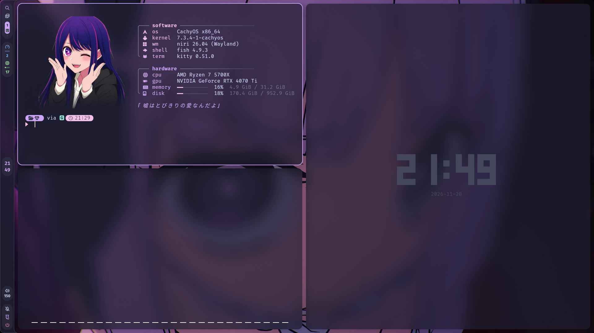
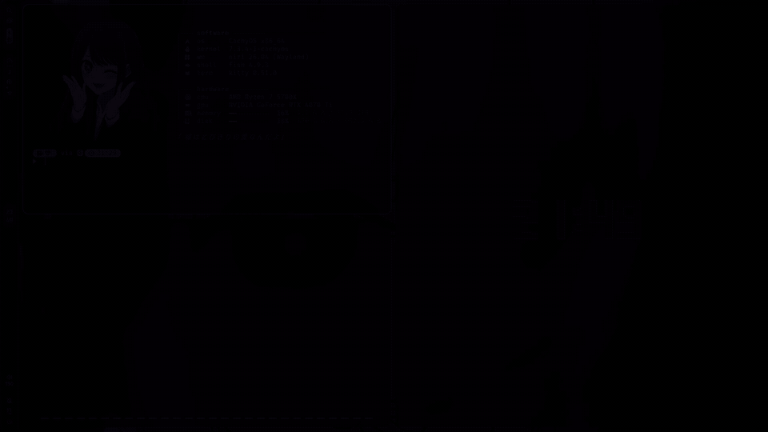

# glass · niri rice

Catppuccin Mocha with pink and mauve accents, frosted see-through windows everywhere.





## What's in it

| | |
|---|---|
| OS | CachyOS |
| Compositor | [niri](https://github.com/YaLTeR/niri) |
| Bar, launcher, notifications | [Noctalia](https://noctalia.dev) |
| Terminal | kitty |
| Shell / prompt | fish + starship |
| Fetch | fastfetch |
| Visualizer | cava |
| Clock | tty-clock (`tty-clock -c -C 5`) |
| Browser | Zen |
| Music | Riff |
| Discord | Vencord |
| Fonts | Geologica (UI), Fira Code (mono), Fira Sans (Noctalia), Symbols Nerd Font |
| Cursor | catppuccin-mocha-mauve-cursors |

## Files

```
.config/niri/config.kdl        layout, blur, animations, window rules, keybinds
.config/noctalia/config.toml   left glass sidebar
.config/kitty/                 kitty.conf + Catppuccin Mocha theme
.config/fish/config.fish
.config/starship.toml          pink pill prompt
.config/fastfetch/config.jsonc
.config/cava/config            pastel gradient
zen/                           userChrome.css, user.js, Rice Glass add-on
discord/glass.css              Vencord QuickCSS
riff/glass.css                 Riff theme
```

## Install

Back up your own configs first, then copy what you want:

```sh
cp -r .config/* ~/.config/
```

**niri**: the keyboard layout is German (`layout "de"`), change it in `input`. Monitors are left to niri's
defaults; add your own `output` blocks if needed. Run `niri validate` after editing.

**fastfetch**: put any PNG at `~/.config/fastfetch/logo.png` (the image in the screenshot is not included).

**Zen**
1. Open `about:support`, click *Open Profile Folder*.
2. Copy `zen/chrome/` and `zen/user.js` into that folder.
3. Zip the contents of `zen/rice-glass/` into `rice-glass.xpi` and drag it into `about:addons`.
   It marks the tab title while a video plays, so niri makes Zen solid instead of see-through.
4. Restart Zen.

**Discord**: install Vencord, paste `discord/glass.css` into *Settings → Vencord → QuickCSS*, and turn on
*Enable window transparency* in Vencord's settings.

**Riff**: load `riff/glass.css` as a custom theme.

**cava**: only the colours are set, everything else is cava's defaults.
